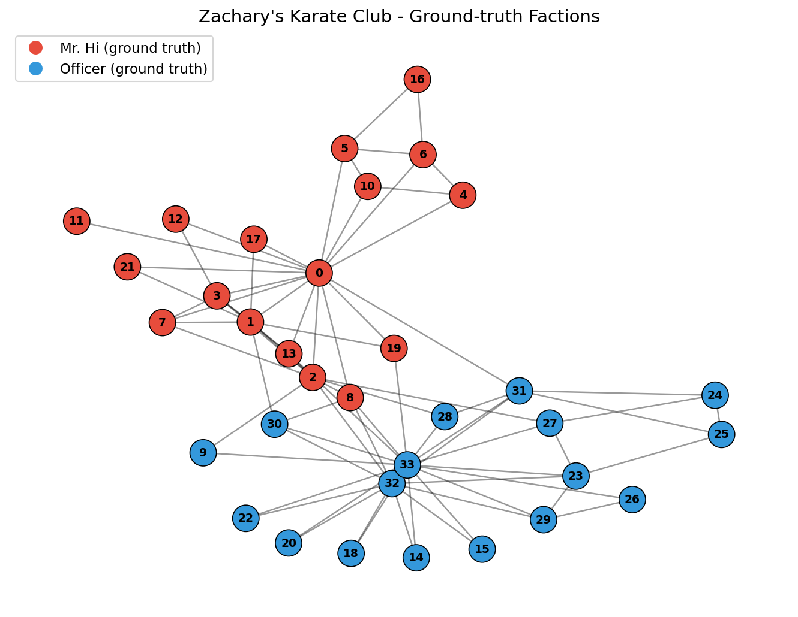
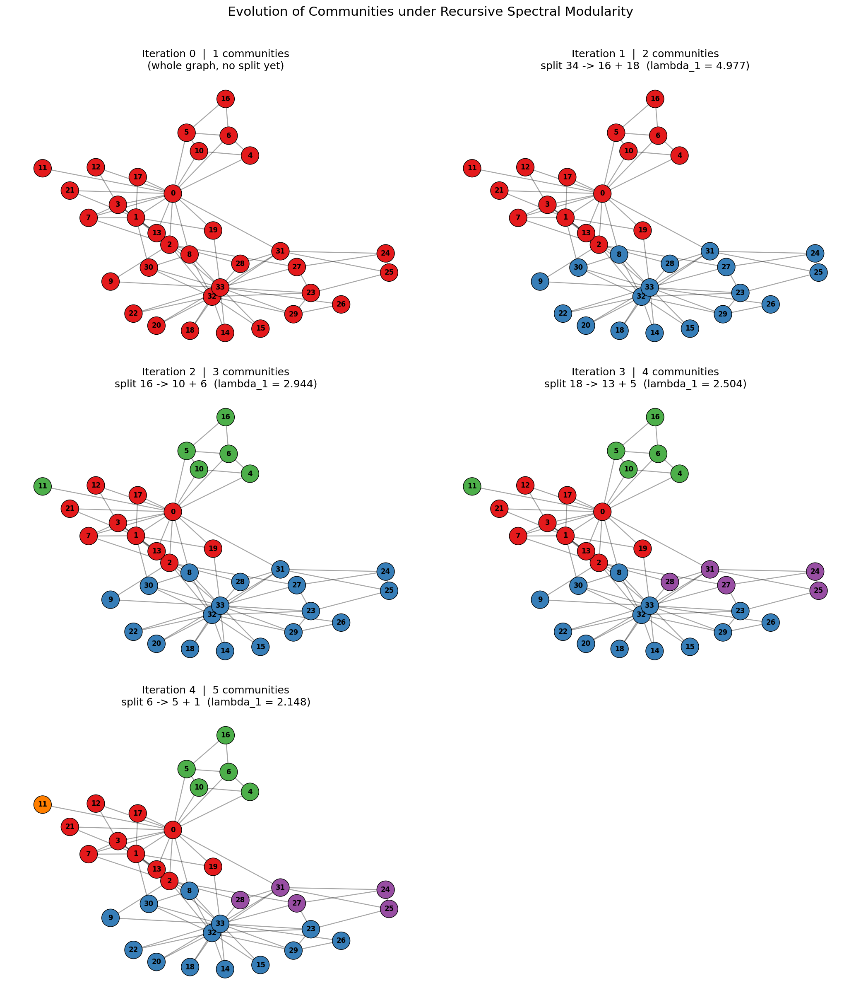
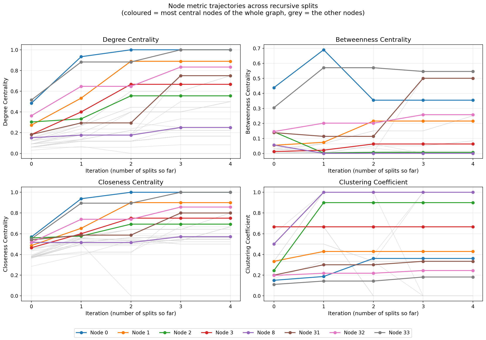
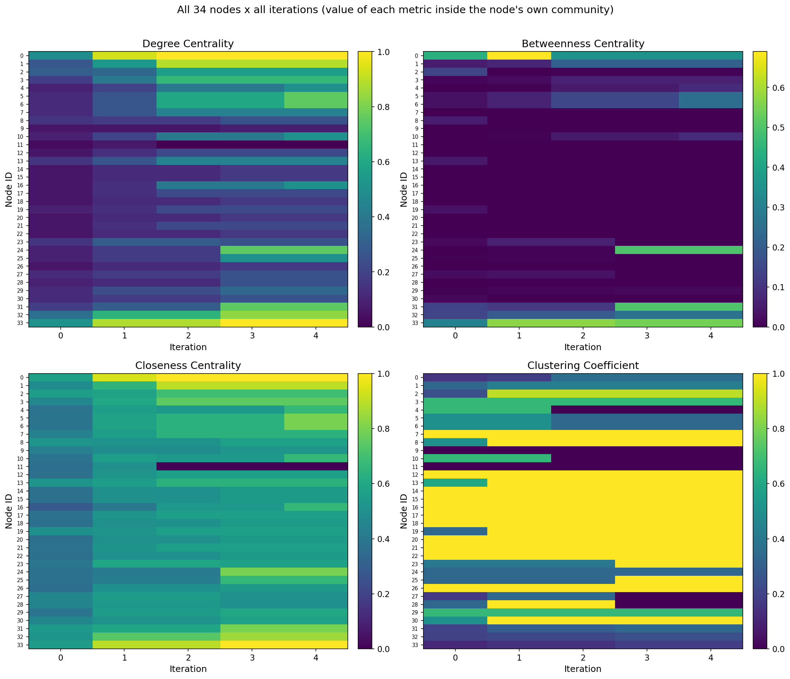
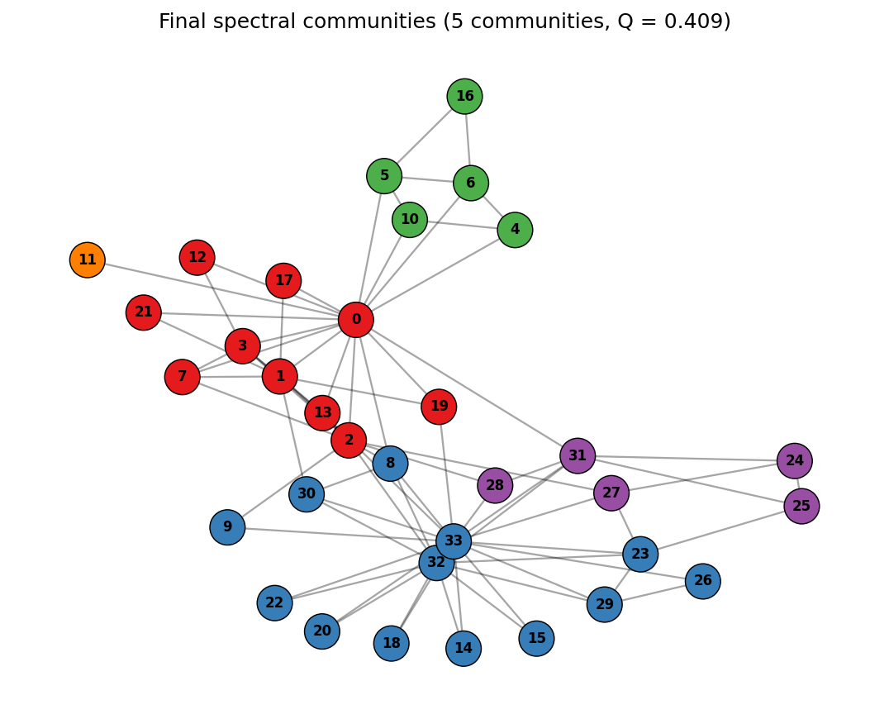

<div align="center">

# Community Detection via Spectral Modularity Maximisation

**Newman's eigenvector-based method, built from scratch and applied to
Zachary's Karate Club network**

*Research assignment · DSC212 — Graph Theory*
IISER Thiruvananthapuram · Instructor: Dr. Saptarshi Bej

</div>

---

## Author

| | |
|:--|:--|
| **Name** | Srashti Bhatt |
| **Roll number** | IMS25206 |
| **Email** | srashtibhatt25@iisertvm.ac.in |
| **Code repository** | https://github.com/srashtibhatt/DSC212-Modularity-Karate-Club |

---

## 1 · Overview

This repository documents a self-contained study of **Newman's spectral modularity method** for community detection (Newman, 2006). Instead of calling any ready-made community-detection routine, the notebook derives everything from the underlying linear algebra:

- it assembles the **modularity matrix** `B = A − kkᵀ/2m` and verifies its two defining properties, symmetry (`B = Bᵀ`) and the null-space condition `B·1 = 0`;
- it grows a hierarchy of communities by **recursive spectral bisection**, where each candidate group is divided according to the sign pattern of the leading eigenvector of the restricted matrix `B⁽ᶜ⁾`;
- it renders the graph after **every single split** — one fixed spring layout, colours inherited from parent to child, original node IDs throughout — so the partition can be watched as it evolves;
- after each split it recomputes **degree centrality, betweenness centrality, closeness centrality and the local clustering coefficient** for every node *inside its current community*, and visualises how all of them evolve through line plots and heat-maps;
- it finally scores the result with the modularity *Q*, compares it with the club's real two-faction split, and discusses which nodes remain structurally central and why.

### Headline results

The very first bipartition reproduces the historical factions for **33 of the 34** members — only **node 8** is placed on the other side — and the recursion terminates at **5 communities with Q = 0.4094**, comfortably above the modularity of the real split (Q = 0.3582): modularity rewards structure in the friendship ties, not the members' actual allegiances. Nodes **0** ("Mr. Hi") and **33** ("Officer") stay the structural hubs at every stage of the analysis.

---

## 2 · Repository layout

```text
DSC212-Modularity-Karate-Club/
├── Modularity_Karate_Club.ipynb     # main notebook — code, outputs, figures, discussion
├── figures/                         # every notebook figure, exported as a standalone PNG
│   ├── 01_ground_truth.png          # the two historical factions
│   ├── 02_partition_evolution.png   # the graph after each of the four splits
│   ├── 03_metric_evolution_lines.png
│   ├── 04_metric_evolution_heatmaps.png
│   └── 05_final_communities.png
├── requirements.txt                 # pinned Python dependencies
└── README.md
```

> The notebook ships **already executed**, so every result and every figure renders directly on GitHub — re-running is optional, not required.

---

## 3 · Getting started

```bash
# 1 — clone the repository
git clone https://github.com/srashtibhatt/DSC212-Modularity-Karate-Club.git
cd DSC212-Modularity-Karate-Club

# 2 — install the dependencies
pip install -r requirements.txt

# 3 — open the notebook
jupyter notebook Modularity_Karate_Club.ipynb
```

Inside Jupyter, `Kernel → Restart & Run All` executes the full study top-to-bottom. The notebook is deterministic — fixed layout seed, sign-fixed eigenvectors — and depends on nothing beyond **numpy**, **networkx** and **matplotlib**.

---

## 4 · What the notebook covers

| § | Section | Focus |
|:--|:--|:--|
| 1 | Environment setup | imports and figure conventions |
| 2 | The dataset | Zachary's Karate Club: 34 members, 78 ties, ground-truth factions |
| 3 | The modularity matrix | `B = A − kkᵀ/2m`; symmetry and null-space checks |
| 4 | Splitting one community | leading-eigenvector sign rule and the stopping criteria |
| 5 | Recursive partitioning | divide-and-conquer bisection over the whole graph |
| 6 | Partition evolution | one snapshot of the graph per split |
| 7 | Node metrics | the four metrics evaluated inside each community |
| 8 | Metric evolution | line plots and heat-maps across iterations |
| 9 | Final results | modularity scores and comparison with the real split |
| 10 | Discussion | enduring hubs, metric behaviour, caveats |
| 11 | Optional extension | Newman's generalised matrix `B⁽ᵍ⁾` and the ΔQ identity |

---

## 5 · Results at a glance

| Quantity | Value |
|:--|:--|
| Splits performed | 4 |
| Final number of communities | 5 |
| Final modularity *Q* | **0.4094** |
| Modularity of the real two-faction split | 0.3582 |
| First-split agreement with the historical record | 33 / 34 members (node 8 is the sole mismatch) |
| Nodes that remain central throughout | node 0 (Mr. Hi) and node 33 (Officer) |

---

## 6 · Figure gallery

<table>
  <tr>
    <td align="center"><br><sub>Ground-truth factions before the club split</sub></td>
    <td align="center"><br><sub>Partition after each split</sub></td>
  </tr>
  <tr>
    <td align="center"><br><sub>Metric evolution — line plots</sub></td>
    <td align="center"><br><sub>Metric evolution — heat-maps</sub></td>
  </tr>
  <tr>
    <td align="center"><br><sub>Final partition — 5 communities, Q = 0.4094</sub></td>
    <td></td>
  </tr>
</table>

---

## 7 · Dependencies

| Package | Minimum version | Used for |
|:--|:--|:--|
| numpy | 1.24 | linear algebra, symmetric eigensolver |
| networkx | 3.0 | graph data structures and metrics |
| matplotlib | 3.7 | all visualisations |
| jupyter | — | running the notebook |

---

## 8 · References

1. Newman, M. E. J. (2006). Modularity and community structure in networks. *Proceedings of the National Academy of Sciences*, **103**(23), 8577–8582. <https://doi.org/10.1073/pnas.0601602103>
2. Zachary, W. W. (1977). An information flow model for conflict and fission in small groups. *Journal of Anthropological Research*, **33**(4), 452–473.
